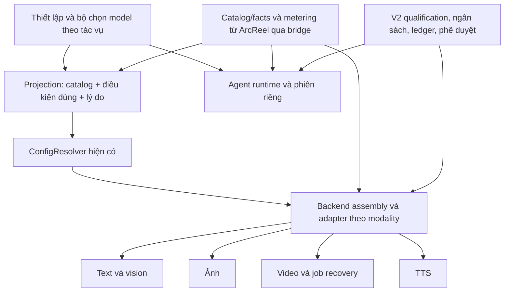

# Rà soát tái sử dụng cho quản lý model toàn V2

Ngày: 2026-10-23. Trạng thái: **nghiên cứu hoàn tất trong phạm vi dưới đây; phương án đề xuất, chưa phải ADR được chấp thuận hay quyền triển khai**.

Yêu cầu: hỗ trợ lựa chọn nhiều model/nhà cung cấp cho mọi phần dùng model, không chỉ viết truyện; ưu tiên mã và quyết định đã có, gồm ArcReel và donor. License nằm ngoài phạm vi theo chỉ dẫn sponsor.

## 1. Kết luận đề xuất

**Mở rộng kiến trúc hiện có của V2; dùng catalog và metering mới của ArcReel làm donor chính, chuyển từng phần qua các interface hiện có.** Giữ các adapter theo loại tác vụ và giữ quyền quyết định thực thi, ngân sách, phê duyệt, phục hồi trong V2. Không xây một nền tảng provider song song; không thay runtime bằng proxy/router bên ngoài.

Đây là kết luận thiết kế từ chứng cứ, không phải tuyên bố đã backport hay đủ điều kiện production. Catalog/meters của upstream là ứng viên tái sử dụng cụ thể, không thể chép nguyên chính sách cập nhật và migration của nó.

Phạm vi chung: danh mục/định danh model, nguồn cấu hình, cách hiển thị lựa chọn, thông tin năng lực, định giá, lý do được/không được dùng, dấu vết từng request. Phần thực thi riêng: text/vision, image, video bất đồng bộ, TTS và Agent. Một model sinh text không mặc nhiên vận hành được công cụ/phiên/quyền của Agent.

## 2. Baseline và giới hạn chứng cứ

- Source V2 khảo sát: `e9da04fb73557e726ffec56b29c31580a97f5150`, worktree `/home/anhtuan/.codex/worktrees/c1b3/content-production-os`. So với production tag `r2-v2.0.6` chỉ có tài liệu bằng chứng phát hành; không có khác biệt mã.
- Production: `r2-v2.0.6` = `8bd86a6c3915281838df15ee16ea4a70c3e20e71`; nghiên cứu này không thao tác DB/config/process production.
- Root checkout ở branch thiết kế cũ, có nhiều dirty paths không thuộc scope; không dùng nó làm baseline runtime và không sửa chúng. Hai bản nháp Gemini-only chưa commit được giữ nguyên; không phải thiết kế đã duyệt của phạm vi mới. M9/M10 tiếp tục tạm dừng.
- Graph Tier 2: project `r2-v2-main`, generation `2026-10-15T01:19:44Z`, khác worktree khảo sát. `search_graph`, inbound trace và snippets xác định các interface; `check_index_coverage` không ghi gap cho các path cốt lõi nhưng story mới thiếu freshness và docs bị loại khỏi index. Đã đọc trực tiếp source pin cho kết luận trọng yếu. Graph không chứng minh danh sách mọi lời gọi outbound là đầy đủ.
- Rà soát tập trung vào nền tảng/model selection, lifecycle và các đường gọi chính. Chưa audit từng call site/transport hay mọi nhà cung cấp. Không benchmark chất lượng văn học, latency, giá thực hoặc quota tài khoản.

## 3. Những phần V2 đã có và nên giữ

Các link source dưới đây được kiểm tra tại baseline mục 2.

| Nhu cầu | Source thực và interface | Kết luận tái sử dụng |
|---|---|---|
| Dựng backend đa nhà cung cấp, đa media | [`assemble_backend`](../../lib/backend_assembly/assembler.py), dòng 100–130; [`ProviderSpec`](../../lib/backend_assembly/specs.py), dòng 37 trở đi và registry 390–458 | Giữ một interface dựng backend. Built-in và custom đi hai nhánh với cùng điểm vào; không dựng factory mới cho từng màn hình. |
| Chọn model theo tác vụ/dự án | [`ConfigResolver`](../../lib/config/resolver.py), `ProviderModel` 58–76, `_resolve_layered_backend` 1231, `text_backend_for_task` 1808; [`TextTaskType/tiers`](../../lib/text_backends/base.py), 163–196 | Tận dụng thứ tự cấu hình đã định. Tách yêu cầu tác vụ khỏi mã hãng; không mở thêm một setting cho mỗi call site. |
| Thực thi text/vision | [`TextBackend`, request/result](../../lib/text_backends/base.py), 195–229 và 338–350; [`TextGenerator`](../../lib/text_generator.py), 29–75 | Đã có interface dùng chung. Result đã có `finish_reason` optional, không cần phát minh trường này lại; phải kiểm tra backend nào thật sự điền nó. |
| Ảnh, video, TTS | [`ImageBackend`](../../lib/image_backends/base.py), [`VideoBackend`](../../lib/video_backends/base.py), 1373–1397, [`AudioBackend`](../../lib/audio_backends/base.py), 18–62 | Giữ request/result theo media. Video có `resume_video(job_id, request)`; TTS có voice, characters; không ép thành chat completion. |
| Context của media | [`GenerationContext`](../../server/services/generation_context.py), 93–117, 159–310 và `resolve_generation_context` | Tái sử dụng kết quả phân giải/lane; cache hit đã kiểm tra lại route qualification. Không làm lớp cache/provider resolve thứ hai. |
| Credential | [`ConfigResolver.provider_config`](../../lib/config/resolver.py), 1164, 1762–1773; [`ProviderCredential.overlay_config`](../../lib/db/models/credential.py) | Giữ nguồn DB và overlay credential đang active; builtin/custom/Agent tiếp tục có cơ chế lưu phù hợp. Không gom secret vào JSON hay env chung để có hình thức thống nhất. |
| Định giá và ghi nhận | [`ModelInfo.pricing`](../../lib/config/registry.py), 39–67; [`pricing/strategies`](../../lib/pricing/strategies.py); [`Ledger.record`](../../lib/ledger.py), 103–189 | Giữ điểm gọi Ledger, repository và reservation. Có thể thay dần phần lấy giá/tính phí sau interface, không thay quyền quyết toán. |
| Ngân sách trước gửi | [`budget_guard`](../../lib/budget_guard.py), 1–130; [`BudgetReservationRepository`](../../lib/db/repositories/budget_reservation_repo.py) | Có nền tảng reserve/claim/reconcile. Hiện text chưa được ước tính đầy đủ ở Ledger nên có floor 0.01; đây không phải bằng chứng hard cap theo chi phí tối đa của mỗi request. |
| Điều kiện release | [`require_paid_route`](../../r2/host_hardening/paid_routes.py), [`is_route_qualified`](../../r2/host_hardening/route_qualifications.py), 231–256 | Giữ qualification theo model, config binding, adapter version, expiry và digest bằng chứng. Có tên trong catalog hoặc models.list không đủ quyền thực thi. |
| Danh sách model trên UI | [`system_config._enumerate_candidates`](../../server/routers/system_config.py), 163–235, `/system/config/model-candidates` 402–429; [`useModelCandidates`](../../frontend/src/hooks/useModelCandidates.ts) | Đã có projection chung cho candidate image/video. Mở rộng read model khi cần, không tạo thêm catalog lưu trữ cạnh tranh. Endpoint hiện chưa đại diện toàn bộ điều kiện admission hay mọi modality. |
| Năng lực sản xuất R2 | [`CapabilityRegistry/Matcher`](../../r2/production_intelligence/capability_registry.py), 1–8, 201–321; [`contracts/capabilities`](../../r2/contracts/capabilities.py) | Có descriptor/observation và UNKNOWN rõ ràng. Chính docstring nói đây là inventory/matcher, không routes provider. Dùng vocabulary và projection phù hợp; không coi là router model đã tích hợp toàn ứng dụng. |
| Agent | [`OptionsAssembler`](../../server/agent_runtime/options_assembler.py), 107–139, 327–434; [`session_manager`](../../server/agent_runtime/session_manager.py); [`agent_provider_catalog`](../../lib/agent_provider_catalog.py) | Giữ phiên, tool permissions, hooks, process cap và budget riêng. Một UI chung có thể biểu diễn cả Agent, nhưng không biến text backend thành Agent runtime. |

**Khoảng trống đã xác nhận:** Story hiện dùng gateway Ollama riêng và lọc `ollama-chat`; `StoryAttemptSink` quyết toán `LOCAL/0` (`runtime.py:734–786`). General Gemini backend có schema fallback và retry nội bộ; nó đọc finish reason để kiểm tra truncation nhưng không điền finish reason vào result, không cộng thoughts usage (`gemini.py:218–295`). Không thể chỉ bỏ bộ lọc UI rồi tuyên bố cloud story an toàn.

## 4. Quyết định và nghiên cứu liên quan

Tất cả ADR local sau có `status: accepted`, ngoại trừ ADR0109 là **proposed**. Tên số upstream là hệ đánh số riêng: upstream ADR0099 về catalog khác local ADR0099 về ComfyUI.

| Tài liệu local | Ràng buộc phải giữ hoặc thay bằng ADR tường minh |
|---|---|
| [ADR0008](../adr/0008-custom-provider-credentials-single-field.md), [0016](../adr/0016-provider-multi-credential-manual-active.md), [0017](../adr/0017-agent-anthropic-credential-injected-per-session.md), [0027](../adr/0027-provider-secrets-banned-from-process-env.md), [0037](../adr/0037-builtin-provider-multi-secret-typed-columns.md) | Built-in/custom/Agent có chủ đích khác nhau về credential; chỉ một active; secret không vào process env chung. |
| [ADR0009](../adr/0009-declarative-model-pricing.md), [0013](../adr/0013-model-level-capability-source-of-truth.md), [0038](../adr/0038-registry-key-decoupled-from-api-model-name.md) | Giá/năng lực gắn model; ID nội bộ khác API model name. Giá tĩnh hiện có không tự chuyển thành runtime-editable chỉ vì upstream đã làm. |
| [ADR0039](../adr/0039-builtin-backend-construction-declarative-seam.md), [0049](../adr/0049-generation-context-single-resolution.md) | Dựng backend chung, resolve một lần; không tạo thêm generic BackendRequest/provider factory phủ lên cùng chức năng. |
| [ADR0051](../adr/0051-text-backend-capability-tiers.md), [0054](../adr/0054-media-model-capability-buckets.md), [0055](../adr/0055-generation-route-locked-at-creation.md) | Text tiers, image/video capability buckets, project-first và generation route cố định. Model cho một tác vụ không mặc nhiên thay mọi tác vụ hoặc Agent. Video resolve lúc thực thi và checkpoint lúc submit; không áp quy tắc freeze story vào cả queue. |
| [ADR0014](../adr/0014-instructor-selective-structured-output-fallback.md), [0044](../adr/0044-text-output-token-nonbinding-ceiling.md), [0047](../adr/0047-text-backend-retry-wraps-single-call-only.md) | Schema fallback theo protocol, retry ở single-call; ceiling text legacy có giới hạn thực tế. Cloud hard cap cần profile mạnh hơn chứ không đổi lời hứa toàn bộ legacy. |
| [ADR0091](../adr/0091-v1-paid-route-qualification-upstream-backport-and-gate-evidence.md), [0093](../adr/0093-v1x-agent-per-connection-budget-in-release-mode.md) | Adapter offline + route live qualification; budget-before-submit và ambiguity. 0093 thay phần Agent của0091: release Agent chỉ chấp nhận tuyến CLI định giá được. Danh mục thống nhất không tự xóa giới hạn này. |
| [ADR0099](../adr/0099-v2-03-comfyui-backport-boundary-and-local-gpu-admission.md), [0100](../adr/0100-comfyui-endpoint-as-second-custom-endpoint-kind.md), [0101](../adr/0101-node-bindings-are-the-only-truth-of-comfyui-endpoint.md) | ComfyUI đã được backport có chọn lọc trên layout phẳng, dùng budget/capacity hiện có; bindings là nguồn năng lực. Tránh tạo bản sao catalog năng lực override lên workflow. |
| [ADR0109, proposed](../adr/0109-story-authoring-routes-models-per-role.md) | Writer/judge đã có mã; cloud cần adapter/qualification riêng. Đây là căn cứ thiết kế, không phải một ADR accepted cho nền tảng mới. |

Nghiên cứu nội bộ đã đối chiếu: [vendor integration](arcreel-vendor-integration-research.md), [video protocols](arcreel-video-api-protocol-research.md), [paid routes và addenda](2026-09-28-r2-v1-06-paid-routes-and-e1-remediation.md), [decision audit](2026-09-28-r2-v1-decision-audit.md), [Agent budget](2026-09-29-r2-v1x-agent-session-budget.md), [ComfyUI reuse](2026-09-29-r2-comfyui-reuse.md), [dependency trace](2026-09-29-r2-v2-03-comfyui-dependency-trace.md), [story cloud readiness](2026-10-19-r2-v2-story-cloud-model-readiness.md), [story donor recheck](2026-10-21-r2-v2-task6-blocks-donor-recheck.md), [Gemini catalog](2026-10-23-v2-gemini-text-model-catalog.md), [research synthesis](r2-origin/01_RESEARCH_SYNTHESIS.md).

Những nghiên cứu này có giá trị theo ngày/pin của chúng. Không coi giá, tên model, trạng thái SDK hoặc câu “chưa có implementation” trong tài liệu cũ là sự thật hiện tại; đã đối chiếu source hiện tại cho các kết luận áp dụng. Decision audit mục7 đã sửa nhận định một canary đủ mọi điều kiện: offline lifecycle qualification và live route canary là hai lớp khác nhau.

## 5. Donor đã đối chiếu mã

### 5.1 ArcReel: donor chính, đã có phần lớn trong V2

Host gốc `v0.29.0` = `6ddedc775e7fe5f398b10081ab741985f7dceda7`, checkout sạch `/home/anhtuan/content-os-r1-8/work/ArcReel`. Nó đã có assembly/spec, media protocols, model metadata/pricing. **V2 đang kế thừa các phần này**, không phải tính năng cần nhập mới.

Upstream mới nhất trong local ref đã kiểm tra: **`258c7ff1ca1f103117cb4f757f7f09fd46cb8647`**, commit 2026-10-22. Đây là pin của lần nghiên cứu, không khẳng định đã fetch HEAD internet mới nhất.

| Mảnh donor mới | Mã tại pin | Đánh giá |
|---|---|---|
| Catalog model dùng chung | [lib/catalog/query.py](https://github.com/ArcReel/ArcReel/blob/258c7ff1ca1f103117cb4f757f7f09fd46cb8647/lib/catalog/query.py), 1–17, `CatalogModel` 80 trở đi; `composition.py`, package `arcreel-catalog-core` | Ứng viên chính thay việc khai báo lặp model. Phân biệt model entry và provider-model route; snapshot hoạt động offline. Không thay credential hay runtime. |
| Facts theo đúng nguồn | [upstream ADR0104](https://github.com/ArcReel/ArcReel/blob/258c7ff1ca1f103117cb4f757f7f09fd46cb8647/docs/adr/0104-capability-sources-split-by-dimension.md) | Tách model facts, channel facts và channel restrictions. Hợp hướng giữ VideoCapabilities/ComfyUI bindings của V2. |
| Chuẩn hóa usage và tính từng request | [lib/billing/metering.py](https://github.com/ArcReel/ArcReel/blob/258c7ff1ca1f103117cb4f757f7f09fd46cb8647/lib/billing/metering.py), `Usage`, `token_usage`, `price_usage`, `price_requests` | Có pure module và tests thật; phân biệt thiếu usage với0, thiếu giá với miễn phí, tính từng request trước khi cộng. Đã chạy thử hẹp ở mục7. |
| Assembly và catalog membership | [assembler.py](https://github.com/ArcReel/ArcReel/blob/258c7ff1ca1f103117cb4f757f7f09fd46cb8647/lib/backends/backend_assembly/assembler.py), 40–110 | Giữ đúng seam và bổ sung `output_limit_facts`; explicit model không thuộc catalog bị từ chối. Có ích, nhưng file donor không có `require_built_backend_qualified` của fork: chép nguyên sẽ mất gate. |
| Agent metering | [upstream ADR0102](https://github.com/ArcReel/ArcReel/blob/258c7ff1ca1f103117cb4f757f7f09fd46cb8647/docs/adr/0102-agent-cost-computed-per-request-from-tokens.md) | Dedupe message và tính theo request là tham khảo tốt. Nó chấp nhận phần usage ẩn/restore được xấp xỉ vì phí tham khảo; không thay thế cap/admission local0093. |

**Những phần không nhập nguyên trạng:**

1. [Upstream ADR0099](https://github.com/ArcReel/ArcReel/blob/258c7ff1ca1f103117cb4f757f7f09fd46cb8647/docs/adr/0099-model-catalog-shared-entries-per-model.md) dùng một giá model chung + hệ số cho chênh giá kênh. V2 phải giữ được giá custom/loại tiền thực đang cấu hình và không khẳng định một hệ số mô tả mọi kênh.
2. [Upstream ADR0103](https://github.com/ArcReel/ArcReel/blob/258c7ff1ca1f103117cb4f757f7f09fd46cb8647/docs/adr/0103-catalog-data-repo-built-from-third-party-sources.md) tự áp dụng cập nhật danh mục. V2 cần snapshot đã xác thực, policy cập nhật và quy tắc invalidation khi facts/giá/adapter thay đổi; không lấy đồng bộ dữ liệu làm quyền mở tuyến.
3. [Upstream ADR0106](https://github.com/ArcReel/ArcReel/blob/258c7ff1ca1f103117cb4f757f7f09fd46cb8647/docs/adr/0106-legacy-data-migration-into-model-catalog.md) chủ động bỏ giá custom cũ. Điều này trái mục tiêu bảo toàn cấu hình/giới hạn của lần này; cần migration riêng có export, mapping và rollback, không chạy migration donor.
4. Layout upstream đã chuyển sang `lib/backends`, `lib/billing`, package catalog/market-core. Không đổi toàn bộ layout V2 chỉ để lấy một module.

### 5.2 OpenMontage: chọn ứng viên theo tác vụ

Pin **`08e2151fa02de28a5d6a312b3d575692bf147ad7`**, local `/home/anhtuan/content-os-r1-8/work/OpenMontage`.

- `tools/video/video_selector.py:248–278,308–440`: discovery theo capability, lọc operation/input, preference có score-gap, giữ identity theo tool để hai adapter cùng provider không bị đè.
- `tools/audio/tts_selector.py:157–200,258–290`: selector riêng cho TTS. `lib/scoring.py:21–70`: score task-fit/quality/control/reliability/cost/latency/continuity có giải thích.
- `tools/cost_tracker.py:40–153,273–324`: estimate/reserve và retry buffer; không phải transaction authority của V2.
- `tests/tools/test_video_selector_routing.py:119–320`: fixture cho cùng provider nhiều tool, preference gap, không fallback từ yêu cầu motion sang ảnh tĩnh. Đã đọc fixture, **chưa chạy mới** trong lượt này.

Tái sử dụng phù hợp: policy xếp hạng/giải thích sau khi lọc đủ điều kiện; không sao chép trọng số như kết quả chất lượng đã đo. Giữ explicit selection; chưa tự bật failover hoặc đổi model đã chọn. Không chuyển local orchestration state của donor thành ledger production.

### 5.3 DramaClaw và DC-Media: quản lý lần gửi request

DramaClaw pin **`b299bfd9f6fc3e4a1eacc580cc03d5868c2e6e83`**, local `/home/anhtuan/.cache/r2-donors/dramaclaw-full`.

- `src/novelvideo/official_media_catalog_schema.py:13–65`: catalog có version, provider/upstream-model identity và request config theo media.
- `model_gateway_runtime.py:87–164,179–287`: context tin cậy, facade theo request, credential resolve lúc submit; organization submit tắt retry tự động của thư viện model.
- `model_gateway_runtime.py:368–445,448–530`: claim operation theo request digest và credential version; replay bị chặn; credential fail → rejected-before-submit; submit exception → unknown; thành công → accepted/completed.
- `tests/test_model_gateway_settings.py` và các tests gateway/restart có sẵn; **chưa chạy mới** trong lượt này.

Đây là donor tốt cho cách biểu diễn egress attempt; V2 đã có M7 và StoryAttemptSink nên phải làm bảng đối chiếu trạng thái trước khi lấy mã. Không thêm operation ledger thứ hai nếu ledger/checkpoint hiện có đáp ứng.

DC-Media protocol pin lịch sử **`0a608d458739226584702943e682da269bf90027`**, `dc-media-protocol.en.md`, manifest digest `966ec07ae7d5bdca62ab5bf96d1c513df882bba37b2750901f271322a4819f23`: chưa đọc lại được protocol file tại pin trong lượt này. Nhận định về protocol chỉ ở mức manifest/nghiên cứu lịch sử, **không đủ điều kiện port trực tiếp**. Source gateway vừa đọc thuộc pin DramaClaw ở trên, không nhập nhằng hai repository/pin.

### 5.4 Huohuo: định tuyến theo vai trò, không lấy fallback

Pin **`f104b853b3563e124d9cde25f9331d323fb483b9`**, local `/home/anhtuan/content-os-r1-8/work/huohuo-drama`.

- `workbench-server/src/services/ai/ai.ts:56–125`: config provider/baseURL/key/model chung; audit có thể dùng provider/model khác writer.
- `text-audit-model.ts:57–112`: resolve route chứa model theo configID/active rows và provider preference.
- `services/ai/adapters/registry.ts:19–82`: các registry image/video/TTS; vendor lạ có thể fallback MiniMax.
- `ai.ts:1098–1183`: retry text có thể gồm nhiều lần trả kết quả rỗng/thinking/transient và tăng token. Billing phụ thuộc context (`381–394`).

Vai trò writer/judge đã được V2 tái sử dụng. Không sao chép silent fallback writer khi audit không resolve, fallback vendor lạ, hoặc retry/billing như quyền thực thi của V2. Không có measured parity mới cho adapter Huohuo trong lượt này.

### 5.5 Novel Studio / Shenbi: bằng chứng lịch sử có pin, không phải donor routing chính

Novel Studio `9b690ae2e2f6921f9bd2782b42cef53c1662ad3b`, Shenbi `65ddfc261f4e491b07c36e548f78de36109be218` có pin trong [story donor baseline](../r2/evidence/R2_STORY_DONOR_BASELINE.json) và nghiên cứu story cloud readiness. Theo nghiên cứu đã có: Novel Studio dùng client OpenAI-compatible và model mặc định dự án; Shenbi cấu hình model và tham số skill. Không đọc lại được source ở pin trong các vị trí donor đã kiểm tra; không kết luận chúng không có khả năng khác. Dùng các kết quả context/story trước đây làm reference, không coi là implementation đã xác minh cho nền tảng model toàn V2.

## 6. Đối chiếu giải pháp ngoài donor chính

Nguồn chính thức đọc lại ngày 2026-10-23; không cài package hoặc chạy proxy.

- [LiteLLM request architecture](https://docs.litellm.ai/docs/proxy/architecture): có gateway, provider translation, router/fallback/retry và spend tracking. [Budget docs](https://docs.litellm.ai/docs/proxy/users) mô tả reserve trước request nhưng cũng nói có đường image/audio thiếu token pricing chỉ kiểm tra recorded spend, và global budget không có DB không tạo hard cap. Đây là bằng chứng không được suy ra “có LiteLLM = mọi media đã có hard cap”. Có thể xem xét như transport tùy chọn sau adapter; chưa pin source, chưa qualification, chưa là dependency được chọn.
- [Vercel AI SDK provider management](https://ai-sdk.dev/docs/ai-sdk-core/provider-management): registry theo provider/model và interface theo modality là đối chiếu tốt. [Settings](https://ai-sdk.dev/docs/ai-sdk-core/settings) cho biết retry mặc định2, có thể tắt bằng0. Không có bằng chứng việc đổi backend Python/runtime của V2 sang SDK TypeScript đem lại lợi ích vượt chi phí và giữ nguyên authority. Chỉ tham khảo cấu trúc, không chọn thay stack; chưa source-pin hoặc parity.
- [Claude Agent SDK overview](https://code.claude.com/docs/en/agent-sdk/overview): tools, permissions, hooks và sessions thuộc agent loop. Một adapter sinh text Claude không đồng nghĩa thay được runtime Agent. Tính tương thích phải xét riêng theo runtime và model/protocol thực.

Không nghiên cứu toàn bộ thị trường gateway; các ứng viên trên đủ để so sánh thay-stack với mở rộng kiến trúc sẵn có. Không đánh giá giá model từ các trang này.

## 7. Kiểm chứng đã thực hiện

### V2 baseline

Command: `env -u DATABASE_URL PYTHONDONTWRITEBYTECODE=1 <existing-venv>/bin/python -m pytest tests/unit/lib/backend_assembly/test_backend_assembly_specs.py tests/unit/lib/config/test_config_resolver_resolution.py tests/unit/lib/test_text_generator.py tests/unit/r2/host_hardening/test_paid_routes.py tests/unit/r2/host_hardening/test_route_qualifications.py -q -n 4 --dist loadfile --junitxml=<evidence>/reuse-tests.xml`.

Kết quả thực: **128 passed, 4 warnings, 8.49s**, không failures/errors/skips. Test process dùng test DB tạm do conftest tạo, không production selector. Đây là xác nhận các hành vi trong năm file, không phải acceptance đa cloud hay full suite.

### Metering donor ArcReel

Trích đúng 11 file từ Git pin `258c7ff1...`: package source `arcreel-catalog-core`, pure metering module, test_metering.py; thêm hai empty `__init__.py` chỉ để import cô lập ở `/tmp/arcreel-model-reuse-258c7ff1`. Không sửa nội dung module/test, không install dependencies.

Chạy pytest của donor với `-c /dev/null`, `--confcutdir` và `--rootdir` ở thư mục trích, PYTHONPATH chỉ trỏ donor root/core; **9 passed, 0.12s**. Không mang conftest của host sang. Lần extraction đầu đặt cwd `/tmp` nên Git không tìm repository và pytest không có file (exit4); đã sửa cwd, extraction và test sau đó đều thành công. Không coi lần 0 tests là pass.

### Same-fixture pure arithmetic

Probe dùng giá fixture tổng hợp, không phải quote giá nhà cung cấp thật:

| Fixture | V2 hiện có | Donor | Kết quả |
|---|---:|---:|---|
| Text, 1.000 input/500 output với0.3/2.5 USD/triệu |0.00155 USD|0.00155 USD|MATCH|
| 3 ảnh với0.04 USD/ảnh |0.12 USD|0.12 USD|MATCH|
| 8 giây video với0.5 USD/giây |4 USD|4 USD|MATCH|
| Text thiếu hoàn toàn usage |0 USD|Unpriced/missing_rate|Khác biệt policy được xác nhận|

**Không suy rộng** thành parity toàn bộ price shapes, cache/reasoning tiers, catalog composition/migration, credential, concurrent budgets, network retry hoặc artifact custody. Core và metering đã có executable evidence hẹp, chưa đủ phê duyệt backport. Probe, JUnit và source hashes được đóng gói cùng evidence JSON của nghiên cứu.

## 8. So sánh phương án

| Phương án | Tái sử dụng | Rủi ro/gap | Kết luận |
|---|---|---|---|
| A. Adapter Gemini riêng và thêm từng bộ chọn ở mỗi màn hình | Dùng SDK sẵn | Cấu hình/kiểm chứng/cost lặp, không giải quyết Agent/media khác | Không chọn cho phạm vi toàn hệ thống. |
| B. Viết một universal gateway mới từ đầu hoặc thay runtime bằng LiteLLM/AI SDK/DC-Media | Thư viện/donor cung cấp transport | Trùng assembly/ledger hiện có, mất khác biệt media/Agent; phải chứng minh lại custody, budgets, approvals | Không chọn làm nền tảng hiện tại. Không phủ nhận có thể dùng một transport phía sau adapter sau này. |
| C. Merge toàn bộ upstream ArcReel mới | Nhiều tính năng đã có | Đổi layout/package/schema và chính sách giá; upstream0091/0099 không đồng nghĩa local0091/0099; mất gate riêng của fork nếu thay file thẳng | Không chọn. |
| **D. Giữ V2 authority và các seam hiện có; backport chọn lọc catalog/metering ArcReel qua bridge, adapter theo modality** | **Tận dụng nhiều nhất phần đã triển khai; source donor và fixture cụ thể** | Cần compatibility/migration matrix và qualification; không thể hứa mọi model dùng ở mọi tác vụ | **Đề xuất tốt nhất trong phạm vi đã khảo sát.** |

## 9. Thiết kế đích ở mức nghiên cứu

**Định danh:** phân biệt model gốc, route nhà cung cấp/account/endpoint và adapter/protocol version. Không dedupe route chỉ vì cùng tên model; không coi alias/model-name matching là chứng cứ cùng giá hoặc cùng quyền dùng.

**Điều kiện:** khả năng model + khả năng protocol/adapter + qualification còn hiệu lực + yêu cầu tác vụ + trạng thái tài nguyên/ngân sách. Catalog là dữ liệu; adapter xác nhận encoding; admission quyết định thực thi. Có thể hiển thị model chưa đủ điều kiện kèm lý do, nhưng nó không được trở thành route chạy được.

**Lựa chọn:** giữ text tiers/media buckets đã accepted; story writer/judge là lựa chọn chuyên biệt; Agent có cấu hình tương thích runtime riêng. Auto-ranking từ OpenMontage chỉ là gợi ý sau khi lọc điều kiện, chưa bật tự đổi model. Không thêm fallback sau lỗi có kết quả chưa xác định.

**Chi phí:** duy trì giá/channel/currency hiện có cho đến migration được duyệt; dùng normalized per-request usage để tăng độ chính xác. Mỗi retry/schema re-ask/count/child request cần đo và giữ ngân sách phù hợp. Thiếu giá hoặc usage là trạng thái rõ ràng; không đánh đồng với0. Giữ giá/giới hạn đã gắn với lần phê duyệt và xử lý thay đổi trước submit; không để đồng bộ giá âm thầm làm thay scope chi tiêu.

**Các công việc chưa có:** embedding/STT/realtime có thể được thêm thành family khi có consumer và adapter cụ thể; hiện không tuyên bố V2 hỗ trợ chúng chỉ vì thiết kế mở rộng được.

## 10. Thứ tự thực hiện đề xuất và điều kiện bắt đầu code

1. **Inventory/crosswalk**: liệt kê và truy tới transport cho các call site text/vision/media/Agent/discovery/trial; mapping cấu hình, credential, trạng thái attempt và bằng chứng release. Bản rà soát này là điểm đầu, chưa phải exhaustive outbound inventory.
2. **Compatibility spike và ADR delta**: chạy cùng fixture cho catalog identifiers/aliases/defaults, giá custom/USD/CNY/free/unpriced/cache/thought/reask, snapshot offline, migration và old brief/checkpoint digests. Chốt phần chọn từ ArcReel; không chạy migration0099/0106 của donor.
3. **Bridge trước**: mở rộng read model/candidate eligibility từ registry hiện tại rồi chuyển từng nguồn đọc sang catalog donor khi parity đủ; giữ một nguồn có thẩm quyền ở mỗi chiều, không dual-write hai catalog. Dùng source facts có provenance/version; giữ protocol facts trong adapter/bindings.
4. **Execution facts/attempts**: bổ sung metadata còn thiếu vào adapter hiện có; giữ từng request dưới budget/qualification và ambiguity policy. Đối chiếu M7/Story/Agent trước khi thêm shared interface; tránh một ledger mới.
5. **Hai tuyến text thực tế đầu tiên**: Ollama + Gemini định hình seam bằng fixtures thật; sau đó Claude/Grok theo adapter tương thích. Tích hợp story là consumer đầu tiên, không đặt logic provider trong module story. Media/Agent chỉ chuyển khi fixture/lifecycle tương ứng đạt, không bị thay model vì thay global default.
6. **Qualification rồi release**: offline tests per adapter/version và live canary bounded theo route riêng. V2 production chỉ đổi sau evidence và quy trình release. Không dùng một canary làm chứng cứ chất lượng dài hạn hoặc restart/cancel đầy đủ.

Các điểm cần quyết định trong ADR tiếp theo: catalogue local-vs-upstream ownership/sync; bảo toàn giá custom và policy thiếu giá; giữ hoặc thay quy tắc Agent cap; alias/retired models; phạm vi per-request telemetry và identity; invalidation khi facts/price/adapter thay đổi. Không cần hỏi lại hãng đầu tiên: user đã chọn Gemini cho bước đầu, nhưng chưa chấp thuận tự động sync giá, bỏ cấu hình cũ hoặc đổi runtime Agent.

**Trạng thái cuối:** đủ bằng chứng để khuyến nghị phương án D và không tiếp tục nhánh tích hợp Gemini-only như thiết kế tổng thể. Chưa có implementation/backport/acceptance mới, chưa có paid generation hay deployment. M9/M10 vẫn tạm dừng.
