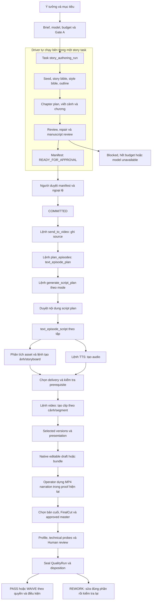
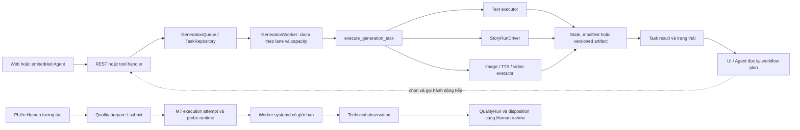

# Khả năng tự động hóa ý tưởng → truyện → kịch bản → phim → Quality

Ngày đánh giá: 30/10/2026. Source được kiểm tra trên release `r2-v2.1.0`, HEAD `0cef69a772f1d2946e452b918a8839b0f37fd2d9`, checkout `r2-v2-release-staging` sạch. Báo cáo được bổ sung ở worktree evidence `r2-m10-c`, base `77b42b2d7b254a5e59db8d7b0a57c53177888293`.

## Kết luận

**Chưa đạt chạy tự động hoàn toàn từ một ý tưởng mới đến một phim hoàn chỉnh được Quality chấp nhận.** Đã có nhiều executor tự động, một story driver chạy nhiều bước và một planner đề xuất hành động tiếp theo. Tuy nhiên, trong các đường thực thi đã kiểm tra, người dùng hoặc phiên embedded Agent vẫn nối các công đoạn. Planner trả lời “nên làm gì tiếp”, worker thực thi task được giao; hai cơ chế đó chưa chứng minh một phiên sản xuất bền vững tự chạy toàn chuỗi.

Cần phân biệt ba mục tiêu:

1. **Tự động thực thi kỹ thuật:** phần lớn thao tác có thể thực hiện bằng tool/API/task, nhưng còn khoảng nối và dựng thành phẩm theo mode.
2. **Tự động đến điểm cần quyết định:** có thể hướng đến chạy tiếp khi đủ prerequisite, dừng đúng tại Human gate, lỗi chưa xác định hoặc giới hạn ngân sách. Đây là đề xuất phù hợp hơn với các ranh giới hiện hành.
3. **Không cần người và bảo đảm phim hay:** chưa được chứng minh; hiện còn xung đột với các endpoint Human-only và không thể suy từ trạng thái thành công kỹ thuật.

Không gán phần trăm hoàn thành: năng lực thực thi, tự nối task, phục hồi và chất lượng sáng tạo cần được đo riêng.

## Workflow hiện tại

Mũi tên bên trong story driver là chuỗi tự chạy. Các nút ghi “lệnh”, “duyệt”, “operator” là điểm chuyển tiếp chưa thể coi là tự chạy xuyên suốt. Sơ đồ tập trung đường narration/storyboard đang dùng; reference-video/drama có các nhánh riêng.

Đường từ MP4 proof sang approved master và Quality trong sơ đồ là **đường cần hoàn tất**, không phải khẳng định clip local đã đi qua các bước đó. PASS/WAIVE cũng không tự đồng nghĩa đã phát hành.

### Đường đi của task

Story service khởi tạo task bằng `TaskRepository.enqueue`; không khẳng định mọi task đi qua cùng một hàm enqueue. Quality probe dùng execution-attempt/runtime riêng, không phải chỉ là thêm một `video` task vào queue media.

| Công đoạn | Đơn vị thực thi và đầu ra | Ai nối bước tiếp theo hiện tại? |
|---|---|---|
| Viết truyện | Một `story_authoring_run`; driver tự chạy nhiều model call, review/repair và tạo manifest | Driver nối nội bộ; người duyệt để commit |
| Handoff truyện | `send_to_video`, upload source và ghi handoff receipt | Người dùng/Agent gọi lệnh sau |
| Chia tập | `text_episode_plan`; planner xử lý theo cửa sổ nguồn | Cần gọi tiếp và theo dõi tiến độ |
| Script plan | `text_narration_script_plan`, `text_drama_script_plan` hoặc `text_reference_script_plan` | Tool/Agent; có review prerequisite |
| Kịch bản | `text_episode_script`, theo tập | Tool/Agent tạo các yêu cầu media tiếp |
| Media | Asset/storyboard, `tts`, `video` hoặc `reference_video`, theo resource | Queue chạy task đã được tạo; caller quyết định yêu cầu tiếp |
| Thành phẩm | Selected versions → presentation → editable draft/bundle; drama có compose skill giới hạn | Narration proof dùng operator FFmpeg |
| Quality | Profile, probe invocation, Human observation, sealed run, disposition | Phiên tương tác, qua các service có authority riêng |

Queue đã có `dependency_task_id`, `dependency_group`, `dependency_index` và batch semantics. **Không kết luận hệ thống thiếu mọi dependency.** Điều chưa được chứng minh là một job xuyên chuỗi tự kết nối story → script → media → approved master → Quality, với trạng thái và phục hồi thống nhất.

## Đánh giá theo kết quả cần đạt

| Mục tiêu | Có gì | Khoảng cách hiện tại |
|---|---|---|
| Ý tưởng → truyện hoàn chỉnh | Driver tự viết/review/repair; đã có hồ sơ run COMMITTED | Chưa chứng minh chất lượng văn học ổn định; commit là trạng thái duyệt/lưu, không phải thước đo “hay” |
| Truyện → kịch bản | Có chia tập, script plan, review gate và script executor | `send_to_video` chỉ handoff source; chưa tự kích hoạt toàn bộ chuỗi sau |
| Kịch bản → clip | Image/TTS/video chạy bằng queue; có proof media local thật | Còn tạo lệnh, chọn delivery, prerequisite, chọn version và xử lý stale/failure |
| Clip → phim hoàn chỉnh | Native timeline/bundle; drama có compose skill | Narration proof dựng MP4 bằng operator FFmpeg; chưa chứng minh đường native một lần chạy đầy đủ âm thanh/phụ đề/nhạc/dựng |
| Phim → Quality chấp nhận | M10 có profile, technical evidence, Human review, run seal và disposition | Clip local chưa đi trọn chuỗi này; kiểm tra container/decode không thay cho factual/narrative/continuity/visual/audio |
| Tự chạy lâu và phục hồi | Có task persistence, execution receipts, checkpoint/recovery theo owner | Chưa có bằng chứng end-to-end crash/restart/resume ở mọi ranh giới trên cùng một sản phẩm mới |

### Những điểm có thể làm hiểu sai trạng thái

**Task succeeded không đồng nghĩa story đã hoàn tất.** `execute_story_run_task` trả `{run_id, phase}` bình thường khi phase không còn RUNNING, kể cả blocked/model unavailable. Worker đánh dấu succeeded khi executor trả bình thường. Một controller phải đọc phase, manifest và approval/currentness; không được dùng một cờ task để tự handoff.

**BLOCKED_QUALITY không luôn có nghĩa truyện dở.** Snapshot đọc-only trước đó lúc `2026-10-30T08:59:15Z` ghi lượt cloud bị dừng vì `OUTCOME_UNKNOWN` ở chapter review: chưa xác định kết quả/usage của request. Đây là trường hợp cần reconciliation, không được mặc định gọi model lại. Trạng thái này là snapshot lịch sử trong ngày, không được refresh ở lần truy vết source này.

**Planner không phải scheduler.** `build_workflow_plan` dựng một status projection và `next_action`; `WorkflowPlanner.get_plan` đọc state/tasks/admission. Embedded skill mới là thành phần đọc `next_action`, gọi subagent và hỏi Continue/Redo/Skip sau mỗi hành động. Bỏ một câu hỏi trong prompt chưa đủ tạo durable automation.

**Export không đồng nghĩa phim đạt Quality.** Skill xem `next_action=export` là kết thúc workflow thao tác, còn Quality có approved-master/profile/run/disposition riêng. Gói editable draft, MP4 phát được, approved master và READY là các mốc khác nhau.

**Có concurrency theo provider/media không chứng minh có khóa GPU toàn máy.** Cần đo tranh chấp Ollama/ComfyUI/TTS khi chạy cùng GPU 8 GB. Proof hiện có chạy serial; đây là giới hạn bằng chứng, không phải kết luận đã có lỗi concurrency.

## Bằng chứng thực tế và giới hạn

Đọc lại [assessment kỳ vọng](2026-10-30-project-expectations-assessment.md), [snapshot trạng thái](2026-10-30-project-expectations-live.json) và [proof ba cảnh](../r2/evidence/media-local-2026-10-30/three-scene-proof/README.md):

- Có story COMMITTED và đã handoff; có run cloud blocked. Đây là hai trạng thái khác nhau, không phải một lượt đầu-cuối thành công.
- Proof local chạy 9 task: 3 ảnh FLUX, 3 audio VieNeu, 3 video Wan; MP4 cuối 6,125 giây. Script được operator soạn, không do story-to-script pipeline tự tạo. Dựng MP4 bằng FFmpeg từ đúng native selections.
- Thời gian worker của ba video khoảng 301/266/266 giây. Không ngoại suy tuyến tính thành tốc độ phim dài vì số cảnh, motion, độ phân giải và số lần sửa sẽ thay đổi.
- Trong snapshot, project proof chưa có QualityProfile/approved master. Không suy danh sách QualityRun rỗng từ request thiếu query hoặc lỗi API.
- Chưa có bằng chứng cùng một ý tưởng mới tự đi hết chuỗi, qua duyệt độc lập, rồi xuất phim đạt tiêu chí đặt trước mà không có operator nối bước.

## Đề xuất khép chuỗi — chưa phải quyết định triển khai

Giữ các owner hiện có: story driver, WorkflowPlan, queue/executors, composition/master và Quality. Bất kỳ bộ điều phối tiếp theo nào cũng nên gọi các contract đó, không tự ghi trạng thái duyệt hoặc xây queue thứ hai.

1. **Định nghĩa một production run và tiêu chí nghiệm thu xuyên chuỗi.** Gắn project, story manifest, episode/script revision, selected media, master digest và QualityRun. Mỗi transition kiểm tra đầu ra có hiệu lực; phân biệt waiting-task, waiting-Human, blocked-budget, unknown-outcome, rework và done.
2. **Nối các đoạn rời trên một lát cắt narration ngắn.** Sau handoff gọi planner, thực thi next_action hợp lệ, xử lý từng tập/cửa sổ, tạo media khi đủ prerequisite; giữ Human gates. Hoàn tất renderer narration từ presentation đã materialize, rồi đi đường approved master/Quality chính thức. Chỉ rerun phần bị ảnh hưởng khi input/version đổi.
3. **Chứng minh tự vận hành trước khi mở rộng.** Ngắt tiến trình giữa các mốc, khởi động lại, kiểm tra không tính phí/generate trùng; thử stale input, unknown provider outcome, hết budget, hết VRAM và REWORK. Đo số lần operator can thiệp ngoài các quyết định đã định trước.

Chu trình Quality mục tiêu là: kiểm tra truyện → kiểm tra khả năng dựng của kịch bản → kiểm tra media từng cảnh → kiểm tra timeline/âm thanh/phụ đề → kiểm tra phim → disposition. M10 hiện được đánh giá cho những capability có bằng chứng, không được suy rằng toàn bộ các lớp sáng tạo này đã tự triển khai đầy đủ.

Chỉ nên gọi “đã tự động xuyên chuỗi” khi một ý tưởng mới tạo được phim đúng tiêu chí, trace được mọi task/artefact, phục hồi được sau gián đoạn, xử lý rework đúng revision và không cần thao tác kỹ thuật ngoài các điểm quyết định Human đã công bố. Đây là tiêu chí đề xuất, không phải acceptance đã có.

## Source anchors và cách kiểm chứng

Các đường code dưới đây thuộc release SHA đầu báo cáo; không dùng source của root cũ để kết luận runtime:

- `server/routers/story_runs.py:138` start; `:176` approve; `:214` send-to-video upload/handoff.
- `server/story_authoring/service.py:203` task enqueue/Gate A; `:312` approve; `:439` handoff.
- `server/story_authoring/driver.py:264` typed stops; `:426` convergence; `:762` prose repair; `:1043` manuscript review.
- `server/story_authoring/runtime.py:54` RunPhase; `server/story_authoring/executor.py:90` execution and phase result.
- `lib/generation_queue.py:413` enqueue/dependencies; `lib/generation_worker.py:526` executor call and `:978` mark succeeded.
- `server/services/generation_tasks.py:3573` story proxy; `:3582` executor registry; `:3600` text/media dispatch.
- `server/tool_runtime.py:539` script preflight; `:571` script-plan dispatch; `:1850` episode-plan submission; `:1873` single text-task execution.
- `server/services/workflow_planner.py:73` status projection; `lib/workflow_plan.py:223` immutable plan builder.
- `agent_runtime_profile/.claude/skills/video-workflow/SKILL.narration.md`: embedded Agent orchestration and per-action confirmation protocol. This was read as application behavior evidence, not invoked as an instruction to generate content during the assessment.
- `server/media_tools/videos.py:1501` target dispatch; narration-delivery arguments require fresh TTS for use_tts.
- `agent_runtime_profile/.claude/skills/compose-video/SKILL.md`: scenes-only, no presentation TTS/subtitle consumption; `server/services/jianying_draft_service.py:231` exact episode materialization/export.
- `server/routers/quality.py:1` Human-only mutation contract; `:789` probe; `:927` seal; `:993` disposition. `server/auth.py:463` interactive credential enforcement.
- `server/services/quality_probes.py:258` replay/unknown-outcome handling, `:361` runtime submission; `server/services/quality_probe_runtime.py:335` bounded systemd worker launch.

Graph Tier 2: `r2-v2-main`, generation `2026-10-15T01:19:44Z`, older than deployed release. Search/trace/coverage used for discovery; story and Quality paths are missing from this generation, embedded profile subtree excluded. Direct deployed-source reads supply material claims and flagged-path fallback. Metadata-match is best-effort, not proof of source equivalence or exhaustive coverage. The finding about absent cross-stage continuation is limited to the traced entry/execution/planner/profile paths, not a claim that no branch or prototype contains automation code.

This turn does not execute providers, approve gates, modify application data, run generation/recovery or repeat historical test suites. It verifies source flow and reads existing operational evidence; it is not a new end-to-end acceptance run. Existing unrelated deletion of `wan-2.2/i2v-proof.mp4` is preserved.
