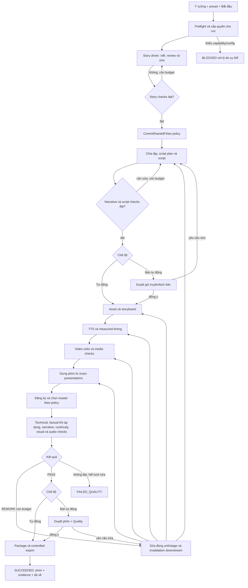

# Workflow sản xuất tự động và bán tự động

Status: **DESIGN APPROVED for implementation planning — product code not implemented**.

Sponsor approval: lời nhắn “tiếp tục” ngày 30/10/2026, trả lời trực tiếp yêu cầu duyệt thiết kế ở commit `5746be25f`. Approval này chốt hướng thiết kế và cho phép lập kế hoạch triển khai; không thay thế runtime/quality acceptance hoặc production rollout gate.

Yêu cầu ngày 30/10/2026: “hoàn thiện workflow mặc định chạy tự động hoàn toàn (có lựa chọn tự động/bán tự động), con người không can thiệp hoặc chỉ thao tác tối thiểu”.

Source baseline: deployed release `r2-v2.1.0`, `0cef69a772f1d2946e452b918a8839b0f37fd2d9`. Thiết kế kế thừa [workflow assessment](../../research/2026-10-30-end-to-end-automation-workflow-assessment.md) và [reuse/authority audit](../../research/2026-10-30-autonomous-production-reuse-and-authority.md). Các tên contract/API mới bên dưới là đề xuất, chưa phải interface có sẵn.

## 1. Trải nghiệm và kết quả

Người dùng nhập ý tưởng, chọn preset hoặc dùng mặc định đã cấu hình, bấm **Bắt đầu**. Workflow mặc định **Tự động**: viết truyện, tự đánh giá/sửa, làm kịch bản, tạo media, dựng phim, đánh giá Quality và tạo gói xuất. Không hỏi Continue/Redo/Skip ở mỗi task. Đóng trình duyệt hoặc kết thúc phiên chat không dừng run.

**Bán tự động** dùng cùng engine, mặc định chỉ dừng ở hai quyết định:

1. Duyệt gói truyện/kịch bản trước khi tạo media.
2. Duyệt phim cùng báo cáo Quality trước khi xuất gói cuối.

Có thể chọn thêm các checkpoint, nhưng không buộc thao tác điều phối kỹ thuật. Các bước nội bộ trước checkpoint vẫn có policy decisions ghi rõ automatic actor; không giả rằng Human đã đọc/duyệt chúng.

Run đầu tiên có thể cần cấu hình một lần về model, budget và Quality preset. Những giá trị đã lưu được dùng lại; không hỏi lại từng cảnh. Không tự mua credit hoặc thêm provider trả phí. Preset trả phí phải có trần chi phí và quyền sử dụng đã được thiết lập rõ trước khi bắt đầu.

Đầu ra thành công: phim MP4 phát được, âm thanh/phụ đề đúng preset, source/script/media/master lineage, QualityRun hợp lệ với disposition PASS, package/export receipt và đường tải. Không coi candidate preview, task succeeded hoặc file MP4 tồn tại là kết quả thành công xuyên chuỗi.

Không gồm tự đăng YouTube/TikTok, thu analytics, hoàn thành M9/M11/M12 hoặc tự thay đổi model/phạm vi ngoài run policy. Không bảo đảm mọi ý tưởng đều tạo phim hay: tự động có thể kết thúc bằng FAILED_QUALITY sau sửa có giới hạn, với artifact và lý do được giữ lại.

### Cardinality và ma trận launch

Mặc định một idea run tạo **một phim/một tập mục tiêu** theo duration preset. User có thể chọn nhiều tập trước Start; tập mục tiêu được đóng băng khi episode planning hoàn tất trong giới hạn số tập/thời lượng đã cấp. Mỗi tập có script/media/master/Quality riêng. Run chỉ SUCCEEDED khi **mọi tập mục tiêu** có PASS và export receipt; không có partial-success terminal. Tập đã đạt vẫn được giữ khi tập khác fail, nhưng run không được báo hoàn tất. Một package tổng tham chiếu các package tập; không tự nối các tập thành phim dài nếu output contract không yêu cầu.

Launch bắt buộc cho **cả auto và semi**:

| Profile | Language/output | Media route và acceptance |
|---|---|---|
| Fiction narration/storyboard | Vietnamese, 9:16, 576×1024, H.264/AAC, voiced narration + subtitles; mặc định một phim 30–60 giây | FLUX `custom-3/flux2-klein-4b-gguf`, Wan `custom-3/wan2.2-ti2v-5b-gguf`, VieNeu `custom-2/vieneu-tts-v3-turbo` từ cấu hình hiện tại; đo actual duration, không ép video 2 giây nếu voice dài |
| Fiction drama/storyboard | Vietnamese, cùng portrait output; một phim 30–60 giây, ít nhất một nhân vật xuyên cảnh và dialogue | Cùng image/video route; speech-composition capability cho character voices phải được qualify, gồm sync và continuity. Chưa đủ capability thì chưa thể nghiệm thu launch profile này |

Text writer/script planner và hai reviewer routes lấy từ role model config hiện có, pin exact provider/model/config digest trước Start; không hardcode ID cloud giả định còn hoạt động. Default text hiện tại trong snapshot là `gemini-aistudio/gemini-3.8-flash`; quyền gọi và trần cost phải được preflight. Chọn preset local-only phải có đủ role models đã qualify và không được fallback sang cloud. Model chỉ được quảng bá supported sau fixture/quality qualification, không vì nằm trong dropdown.

Reference-video, ad/product, factual sourced-video, ngôn ngữ khác và độ phân giải khác không thuộc launch claim này; vẫn giữ các workflow thủ công hiện có và thông báo rõ capability trước Start. Không âm thầm đổi content/generation mode của project cũ. Full-auto trên những profile đó là packet mở rộng sau, không được báo đã hoàn thiện nhờ hai profile trên.

**Drama speech route gate:** route dự kiến đầu tiên là VieNeu `custom-2/vieneu-tts-v3-turbo` cho từng character voice qua speech-composition owner, dùng voice/reference assets được cấp trong run; đây là candidate chưa được qualify cho drama. Trước Packet 3 phải đóng research/fixture gate về multi-character routing, measured timing và yêu cầu lip sync cho shot có nhân vật nói on-screen. Wan silent video + audio overlay không tự được coi đạt lip sync. Nếu route hiện tại không đáp ứng, phải chọn và ghi rõ một route/adaptor thay thế bằng source/capability/cost evidence trong design addendum trước implementation media drama; không fallback sang narration hoặc thêm paid provider ngầm. Narration controller/text work có thể tiếp tục độc lập; launch claim drama vẫn blocked đến khi gate này đạt. Đây là prerequisite có chủ ý, không phải khả năng host đã chứng minh.

## 2. Cách thực hiện và các lựa chọn

**Đề xuất: bộ điều phối bền vững trong backend, dùng lại các owner hiện tại.** Đây là hướng đã trình bày cho sponsor trong lượt này; thiết kế và lựa chọn vẫn đang chờ phê duyệt cuối.

| Cách | Tradeoff | Kết luận đề xuất |
|---|---|---|
| Backend production run + owner adapters | Cần persistent run/decision/intent và authority contracts; dùng lại queue, executors, planner, receipts, M7, M10 | Phù hợp yêu cầu đóng trình duyệt vẫn chạy và phục hồi |
| Chỉ sửa prompt để Agent tự bấm tiếp | Ít code ban đầu; phụ thuộc session, khó chứng minh resume và không giải quyết Human-only service authority | Không đủ làm workflow mặc định |
| Workflow engine ngoài host | Có orchestration primitives; thêm runtime, persistence và migration vận hành | Chưa có gap chứng minh cần thay substrate |

Đây là thay đổi xuyên module, persistence và authority; không thể hoàn tất bằng một toggle UI. Chỉ tạo implementation plan sau khi thiết kế được sponsor duyệt.

## 3. Workflow mục tiêu

Sơ đồ giản lược scheduling: TTS có thể chạy sau script và độc lập storyboard, nhưng các task dùng chung GPU được tuần tự hóa theo admission thực tế. Không thêm dependency bắt buộc TTS phải đợi storyboard nếu không cần.

## 4. Production run và task routing

Thêm một owner orchestration nhỏ; không sở hữu Canon truth, approved-master truth, provider jobs hoặc Quality verdict thay các owner đó.

- `ProductionRun`: user/project/run ID, mode, frozen preset/policy/version/digest, input scope/digest, output contract, revision/generation, stage, status, reason, budget, created/updated timestamps, due time, lease holder/expiry và fencing epoch.
- `ProductionRunStep`: stable stage/unit key, input fingerprint, policy digest, attempt/repair index, durable dispatch intent, owner command ID/task ID, output refs/digests, prerequisite receipts, status/reason và generation fence.
- `AutomationGrant`: issuer, automation principal, user/project/run scope, allowed operations, allowed provider/model/cost limits, expiry/revocation/version. Lưu proof và kiểm tra lại khi thực hiện command.
- `AutomationDecision`: actual actor, grant version, rule/profile, exact subject digest, evidence, decision, command identity và thời điểm. Human decision lưu đúng Human actor; không đổi ý nghĩa receipt cũ.

Owner-specific records là authority. Run/step chỉ giữ refs và projection cần điều phối. Chi tiết bảng/migration phải được chốt trong implementation plan và theo layering/conventions host.

Luồng task: controller đọc state có hiệu lực → WorkflowPlan hoặc stage-specific owner → tạo durable intent → gọi adapter bằng stable command/task ID → queue/owner chạy → controller kiểm tra receipts và outputs → chuyển bước.

| Stage | Owner/adapter cần dùng | Điều kiện chuyển tiếp |
|---|---|---|
| Story | Existing StoryRunDriver, commit và handoff | Phase/manifest chính xác, policy review pass, commit/handoff receipts có hiệu lực |
| Planning/script | Existing plan_episodes/script-plan/script executors | Tất cả cửa sổ nguồn/tập mục tiêu có revision và review đủ; không chỉ xử lý tập đầu tiên |
| Asset analysis/prompt preparation | Existing inventory/formal-write tools; bổ sung bounded structured adapter cho surface chỉ có ở embedded skill | Schema, expected source revision và manifest được validate; không ghi file tùy ý qua chat |
| Media | Existing image/TTS/video/reference executors, batch/dependencies | Current selected resource versions, speech/timing admission, media checks; task success không đủ |
| Render | New adapter tiêu thụ existing PresentationReadModel | Manifest phim và digest khớp exact selections; decode/audio/subtitle checks pass |
| Master | Existing promotion/master transaction, extended actor authorization | Candidate/contract/source masters/audio decision/currentness hợp lệ |
| Quality | Existing M10 services/kernel, thêm qualified automated evidence producers và authorization | Profile/subject/run/disposition current; thiếu evidence không PASS |
| Package/export | Existing package selection/export owners qua authorized automatic actor | Đúng selected master và current PASS, verified download bytes |

`WorkflowPlan.next_action=export` không tự kết thúc production run mới: renderer/master/Quality/package là những stage có authority riêng. Planner không đọc run metadata rồi tự cấp lại sự thật cho owner.

## 5. Scheduling, idempotency và phục hồi

Run scanner được gắn lifecycle backend theo pattern scheduler host hiện có. Scan các run đến hạn, claim bằng transaction ngắn, CAS/lease/fencing. Không giữ DB lock trong lúc chờ model, GPU, process hoặc người duyệt. Mỗi quyết định mới phải revalidate generation, policy/grant và owner heads ở transaction cuối của owner.

**Intent trước dispatch:** ghi step/command identity trước khi gọi owner. Nếu owner và run không chia sẻ transaction, dùng stable owner command ID/task ID và receipt replay. Sau crash giữa owner enqueue và ghi task link, scanner tìm/replay đúng command rồi gắn lại, không gửi một request model mới. Adapter không có replay contract phải được bổ sung ở owner trước khi bật auto; không đánh dấu “exactly once” chỉ vì dispatcher có lock.

Task terminal SSE là wake-up hint để giảm độ trễ. Scanner định kỳ đọc DB/owner state là đường phục hồi bắt buộc. Không đổi list `terminal_events` trong session thành durable event truth bằng suy diễn.

- Hai scanner cùng thấy một step: tối đa một logical dispatch, được chặn bằng unique intent/command và fencing; late worker không thể ghi vào generation mới.
- Run pause/cancel/revoke ngăn dispatch mới; task đang chạy được cancel/reconcile theo M7 và owner semantics. Không xóa artifact hiện có.
- Story task trả `succeeded` nhưng phase blocked/ready-for-approval: đọc phase và policy, không chuyển thẳng sang video.
- `OUTCOME_UNKNOWN`: reconcile theo provider/attempt receipt trước. Không blind retry hoặc tự reset attempt. Không resolve được thì BLOCKED_UNKNOWN; auto mode không chuyển thành câu hỏi bắt người dùng bấm tiếp ở mọi lần scan.
- Retry chỉ cho lỗi đã xác định là an toàn hoặc failed-before-acceptance; backoff có giới hạn và cùng command identity khi replay. Quality rework tạo revision/attempt mới có quan hệ rõ với bản cũ.
- Chỉ invalidation các downstream step phụ thuộc input đã đổi. Chặn stale result/currentness như host đang làm; không overwrite selected versions vì filename giống nhau.

Trạng thái run đề xuất: `PENDING`, `RUNNING`, `WAITING_TASK`, `WAITING_REVIEW` (semi-only checkpoints), `PAUSED`, `BLOCKED_CONFIGURATION`, `BLOCKED_RESOURCE`, `BLOCKED_BUDGET`, `BLOCKED_UNKNOWN`, `FAILED_QUALITY`, `FAILED`, `CANCELLING`, `CANCELLED`, `SUCCEEDED`. Mọi blocked state có reason và resume action; resume chỉ chạy khi prerequisite/authority đã hợp lệ, không bỏ chặn bằng cách đổi status.

## 6. Authority: cho phép tự động thật, giữ provenance thật

Thay đổi chính sách là chủ ý của yêu cầu mới. Cần ADR amendment và hợp đồng có phiên bản cho **automatic run-scoped authority**, áp dụng tới narrative/Canon/Plan/adaptation, relevant A/B/C, Quality và packaging/export. Không chỉ nới `InteractiveUser` thành API-key user hoặc tái sử dụng JWT Human trong daemon.

Một lần Start của user đã xác thực cấp quyền cho đúng run theo preset đã cấu hình. Daemon dùng service principal và grant của run; không giữ password/JWT phiên browser. Mỗi owner kiểm tra operation, user/project/run, exact subject/digest, policy version, expiry/revocation và budget dưới lock/currentness tương ứng.

**Issuer eligibility:** người Start/delegate phải có current signed project Showrunner grant qua Governance và đủ entitlement cho từng operation trong delegation. App admin/API authentication đơn thuần không đủ. Issuer không thể cấp quyền mình không có; Candidate Writer và model reviewer không được phát grant. Governance custodian là trust root cho namespace delegation có version, với operation `DELEGATE_AUTOMATION`; controller chỉ dùng grant đã cấp, không tự ký/cấp lại. Nếu mất/revoke quyền của issuer hoặc child grant, các command mới bị chặn; proof được revalidate ở owner transaction. Read/replay evidence cũ không tạo quyền làm side effect mới.

| Delegated operation family | Automatic actor được làm | Điều kiện |
|---|---|---|
| Idea/story/narrative | Greenlight run input, review/commit/handoff Canon/Plan và admission revision cần thiết | Exact manifest/input; qualified assessments đạt; không tự chấp nhận blocking narrative exception |
| Script và adaptation | Lock/admit current script/plan cho những profile của run | Exact source/script/profile; required checks pass |
| Media/master | Dispatch trong budget, chọn shot/final candidate và promote qua owner | Hash/dependency/audio/currentness đúng; không cấp READY chỉ từ promotion |
| Quality | Dùng pre-published qualified auto profile theo preset, observations, seal và PASS/REWORK | Không có quyền publish/change profile; không giả Human slot; không WAIVE |
| Package/export | Select/package/download artifact trong run | Current master và PASS; private authenticated access |
| Publication/Gate D | Không được cấp mặc định | Ngoài scope production grant |

Các hợp đồng hiện chứa literal Human phải có versioned authorization variants/ports và persistence compatible. Không mở rộng một chuỗi tùy ý rồi cho mọi API key tự nhận automation role. Read/replay của Human records cũ giữ semantics; migration không chuyển các decision cũ thành automatic, không bật run trên project lịch sử.

**Semi mode không có nghĩa mọi quyết định nội bộ đều Human.** Nó dùng automatic grant cho stage nội bộ nhưng pause ở hai checkpoint đã công bố. Human approval ở checkpoint gắn với exact narrative package hoặc exact film/Quality bundle; người sửa input làm approval cũ không còn current.

Gate D và publication authority không được cấp trong grant production mặc định. Automatic export là tải/gói nội bộ, không phải upload công khai.

## 7. Quality và vòng sửa

Quality preset công bố rule, applicability, producer qualification, independence, threshold và tool/model identity trước khi chạy. Không để model viết nội dung đồng thời tự tuyên bố đạt; proposer, assessor và deterministic decision policy có vai trò tách biệt.

- Tận dụng `AssessorClass.MODEL` và assessment slots hiện có. Model observations phải do adapter được qualify tạo ra, lưu model/prompt/tool/input/evidence digests; không dùng `HumanObservationService` để đóng vai người xem.
- Default auto profile dùng model/deterministic assessments đáp ứng mục tiêu tương ứng; không đổi lớp HUMAN thành MODEL trong một published profile cũ. Profile có HUMAN-required slot không được auto-satisfy. Cần profile version mới và qualification trước khi bật default auto.
- Narrative: cấu trúc, động cơ, setup/payoff, mâu thuẫn, language và factual checks khi áp dụng. Script: coverage truyện, shootability, thời lượng, lời thoại/voiceover và consistency. Media/final: identity/continuity, relevance, motion defects, image/video/audio integrity, TTS pronunciation/content, subtitle timing/readability, loudness và decode.
- Technical probes chỉ tính vào những rule chúng đo thật. Không dùng container/decode làm proxy cho perceptual hoặc narrative quality. Factual preset cần sourced evidence thực, không tự tạo fact để lấp slot; thiếu nguồn phải block trước khi sản xuất đắt tiền.
- Calibration bằng corpus có positive/negative cases và cohort/language phù hợp. Các reviewer dùng chung model/prompt/context không tự trở thành hai independence groups; identities/groups do server registry quyết định. Material disagreement không auto-PASS bằng cách lấy điểm trung bình.
- Repair plan chỉ rõ finding→unit/stage→expected revision; deterministic policy xác nhận scope trước enqueue. Sửa story/script làm invalidation downstream; sửa audio phải rematerialize timeline và re-render/reassess phần liên quan.

Default đề xuất: tối đa 2 vòng sửa cho một unit/stage và tối đa 3 lượt đánh giá final. Cả hai còn chịu trần tổng model calls, tasks, thời gian và chi phí đã đóng băng; không nhân vô hạn số vòng giữa các stage. Không tự WAIVE critical finding, chấp nhận narrative exception hoặc hạ threshold. Hết vòng/cap: FAILED_QUALITY hoặc BLOCKED_BUDGET, giữ candidate và report.

Master selection diễn ra trước M10 run vì M10 hiện đánh giá approved master. Auto selection này là quyết định theo policy có provenance; nó chưa cấp READY/export. Final Quality PASS và package selection là các điều kiện bổ sung, tránh vòng phụ thuộc “phải Quality trước mới có subject Quality”.

**Bootstrap profile:** project Showrunner/Governance-qualified profile publisher phê duyệt một lần versioned default auto profile trước khi bật tính năng; controller không tự nới rule hoặc publish profile từ model output. Đây là setup/release qualification, không phải thao tác duyệt mỗi phim. Launch cần deterministic checks và hai model assessor identities khác writer, khác model identity nhau, separate blind contexts; giữ material disagreement thành finding. Mỗi reviewer phải được registry qualify cho language/profile, không tự nhận independence group.

Minimum launch qualification đề xuất: ít nhất 20 labeled calibration items/profile (10 clean, 10 có lỗi), rồi 20 held-out items/profile (10 clean, 10 có lỗi) mà assessor không thấy label. Corpus phải gồm các critical narrative/continuity/audio/subtitle/visual defects được thiết kế độc lập với producer. Tất cả critical negative items phải bị chặn, ít nhất 8/10 clean hold-out items được nhận đúng; khai báo phân bố, disagreements và false positives. Các rule sáng tạo dùng rubric 1–5 có anchors, mọi dimension bắt buộc phải >=4 từ cả hai assessor, không lấy trung bình để che một dimension fail. Đây là ngưỡng launch do người triển khai đề xuất để sponsor duyệt, không phải chứng cứ chất lượng thương mại đã có. Mỗi model/prompt/rubric đổi version cần requalification; technical measured thresholds bám preset/tool qualification riêng.

## 8. Render, audio và tài nguyên

Renderer lấy một materialized episode snapshot qua PresentationReadModel, không tự chọn lại clip/TTS từ tên file. Dùng timing/delivery/audio policy và subtitles có sẵn; chuẩn hóa codec/frame rate/sample rate theo output contract. FFmpeg argv có cấu trúc, bounded runtime/output/scratch; không thực thi shell text do model sinh.

Giữ nguyên source media. Output staging được decode/measure, hash và commit theo artifact/master owners; chưa đăng ký thì chỉ là candidate. Renderer bị gián đoạn không được để file `.mp4` chưa hoàn thành thành selected final. Reopen/replay dùng đúng tool/input manifest và hashes; không hứa byte-determinism của inference.

Host RTX 2070 8 GB cần admission cho **managed GPU workload xuyên Ollama, ComfyUI và TTS**, không chỉ image/video lane riêng. Dùng một device lease có fencing và kiểm chứng quiescence trước khi tái cấp. Lease hết hạn không chứng minh process/GPU job đã dừng. Lưu route/model snapshots; nếu service ngoài controller vẫn giữ GPU, wait/backoff hoặc BLOCKED_RESOURCE theo policy, không gây vòng restart vô hạn.

Preflight free disk trên Linux và model/media D, capability/model availability, GPU envelope, Quality qualification và cost caps trước công việc đắt tiền. Chặn thiếu capacity; không tự xóa model/media/backup. Budget reservations dùng owner ledgers/receipts và bao gồm review/repair/render; unsupported cost ceiling phải block preset trả phí thay vì đoán giá.

## 9. UI/API và rollout

UI: chọn **Tự động / Bán tự động**, default auto cho run mới; một nút Start; progress theo stage và task; xem film/Quality; Pause/Resume/Cancel; hiện một review card tại checkpoint semi. Không đưa command IDs, locks hoặc câu hỏi kỹ thuật vào flow người dùng thông thường. Backend điều phối kể cả khi không có embedded Agent session.

Optional checkpoints ở launch chỉ gồm bộ hữu hạn: `STORY_MANUSCRIPT`, `SCRIPT_PACKAGE` và `FINAL_FILM`. Semi mặc định `SCRIPT_PACKAGE` (hiển thị cả truyện) + `FINAL_FILM`; auto không có routine checkpoint. Quyết định review dùng `APPROVE` hoặc `REQUEST_CHANGES` với stage/unit IDs, expected package digest/generation và note; không nhận free-form shell/tool commands. Note được biên dịch thành typed repair proposal rồi validate scope. Sửa truyện invalidates script+media phụ thuộc; sửa script invalidates những unit downstream tương ứng; sửa final edit không tự viết lại truyện. Human chọn revision khác là một input change có provenance, không overwrite artifact.

**Concurrent edits:** run-owned revision changes đi qua repair protocol và tăng generation. Khi authoritative head đổi ngoài run (UI/Agent khác hoặc manual edit), run dừng `BLOCKED_INPUT_CHANGED`, giữ output cũ, không tự adopt hoặc fork thành nguồn mới. User có thể Resume với expected new input digest và scope/budget được cấp lại; đây là ngoại lệ xung đột, không routine prompt trong auto. Claim/check cuối của owner phải chặn head movement xảy ra sau plan read. Thêm `BLOCKED_INPUT_CHANGED` vào status set ở §5.

API đề xuất: create/read/list production runs, pause/resume/cancel, submit checkpoint decision với expected version/digest. Automatic grant được server tạo sau auth/authorization và policy resolution, không nhận actor/grant proof tùy ý từ body. SSE dùng channel hiện có, có DB read fallback.

Project/run cũ không tự chạy khi deploy. Chỉ run mới sau Start dùng default auto; stored mode trên active run không đổi ngầm. Chuyển auto→semi pause tại safe boundary; semi→auto cần user xác thực xác nhận phạm vi delegation mới và version mới, không tự cấp grant từ background worker. Policy tăng quyền/chi phí không có hiệu lực giữa run nếu chưa được cấp lại.

**Package/download contract:** dùng accepted package/export format và receipt owners hiện có, thêm run-level manifest versioned tham chiếu episode/package/export IDs/digests. Bắt buộc mỗi tập có final MP4, subtitle sidecar, Quality summary và lineage manifest tới source/script/media/master; editable draft chỉ thêm khi preset yêu cầu. Download xác thực đúng user/project, dùng immutable verified archive và stream integrity protocol hiện có; không anonymous static URL. Launch không đặt TTL xóa tự động: giữ bản final và failed candidates đến khi user thực hiện retention/delete rõ ràng. Failed candidate có preview riêng và trạng thái không đạt, không nằm trong successful export selection. Run success kiểm tra hash/size của archive và final cùng các current owner receipts, không chỉ kiểm tra URL tồn tại.

UI text dịch đầy đủ các locale theo `frontend/src/i18n/`. Sử dụng style/components hiện có; không redesign toàn bộ app trong packet orchestration.

## 10. Implementation gates và nghiệm thu

Sau design approval, viết implementation plan trên worktree cô lập từ deployed base; giữ root dirty và branch Claude khác. Các packet tuần tự, không triển khai giả “đã hoàn thiện” chỉ sau packet đầu:

1. **Contracts/authority/persistence:** ADR amendment, automation grant/decision, version compatibility, transaction/lock ordering, budget/lease and intent semantics.
2. **Run controller và text adapters:** resumable orchestration, story/Canon/handoff, all episode windows, script/inventory/prompt tasks; auto/semi checkpoint logic.
3. **Media và renderer:** resource admission, revision dependencies, native final MP4, registration/master promotion.
4. **Automated Quality và rework:** qualified producers, auto profiles, M10 seal/disposition/package/export authority adapters; UI/i18n integrated.
5. **Acceptance và rollout:** fresh E2E, crash/recovery/concurrency, resource/cost evidence; deploy chỉ sau các gate đạt.

Test bắt buộc gồm:

- Unit state/decision boundaries: task success ≠ stage pass; profile HUMAN slot; missing/failed validator; assessor conflict/disagreement; quality failure never becomes SUCCEEDED.
- Real PostgreSQL: two controllers/lease expiry, command replay, revocation and profile/master/input movement at final transaction, crash between intent→enqueue→link, old schema/record compatibility và migrations. SQLite/unit mocks không thay các interleavings này.
- Integration real media: presentation→MP4 có TTS/subtitles đúng timing, source hash lineage, decode/stream structure, stale selection refusal, cancel/timeout/scratch handling và no-write-on-refusal.
- Mode parity: auto không có routine prompts; semi đúng hai review checkpoints; không tự đồng ý thay người; mode change và historic project không autostart.
- Runtime: đóng browser, restart backend/worker giữa các stage, replay duplicate terminal notifications; không duplicate paid submit; UNKNOWN không bị rerun mù.
- Fresh product acceptance: narration Việt và drama trên các mode/preset được tuyên bố supported. Narration ít nhất 3 cảnh và đủ thời lượng/complexity để kiểm tra storytelling/audio; không dùng lại script operator fixture làm bằng chứng idea→story→film. Reference/ad profiles chưa được qualify phải được hiển thị là unsupported trước Start, không bị âm thầm chuyển mode.
- Quality negative acceptance: cố ý sai continuity, thiếu narration, subtitle lệch, clip lỗi/decode failure, fact không nguồn và stale script; chứng minh block hoặc repair đúng scope. Calibration và verdict không lấy từ chính expected labels đã tiết lộ cho assessor.

Gate cuối phải chứng minh **một ý tưởng mới → phim → current Quality PASS → verified package/download**, tự chạy sau Start trong auto mode, cùng lineage/usage/intervention log. Báo cáo riêng quality đạt, thời gian, chi phí, số lượt sửa và số thao tác ngoài dự kiến; không quảng cáo “chất lượng thương mại bảo đảm” từ một lượt thành công.

Chạy actual selected tests theo CONTRIBUTING; thay DB/profile/i18n/shared contracts cần affected-domain full gates. Không tính collect-only, supplied results hoặc sandbox-denied setup là pass. Tests chưa chạy trong giai đoạn thiết kế.

Builder clarity check theo skill đã thực hiện bằng một reviewer read-only, không sửa source hay gọi provider. Vòng đầu nêu 7 câu hỏi về delegation, cardinality, launch profiles, qualification, checkpoints, concurrent edits và package contract. Sau khi bổ sung, 5 mục được đánh giá planning-clear; 2 điểm còn lại đã được ghi rõ: automation chỉ **use** pre-published profile, và drama speech/voice/lip-sync route có research/fixture prerequisite trước implementation Packet 3. Đây là kiểm tra khả năng lập kế hoạch, không phải critical architecture acceptance hoặc runtime test.

## 11. Quyết định do người triển khai đề xuất và các hạn chế còn lại

Các chi tiết do người triển khai đề xuất, sponsor chưa duyệt riêng: backend controller; default semi hai checkpoint; không auto-publication; repair caps 2/unit và 3/final; run-scoped automation principal thay Human impersonation; historical projects không autostart; blocked/failed là kết quả hợp lệ của auto mode; hai launch profiles và duration/output preset; per-run all-target success; qualification corpus/ngưỡng rubric ở §7; no automatic retention deletion.

Numeric budget, model routes và commercial/perceptual thresholds không được bịa trong thiết kế: resolve từ preset hiện có khi có đủ proof hoặc cấu hình một lần trước Start. Thiếu qualified evaluator hoặc renderer adapter là blocker triển khai thật; không phải lý do thu hẹp mục tiêu thành “auto đến Human gate” rồi gọi hoàn tất.

Design approval cho phép bước tiếp theo là implementation plan; chưa phải bằng chứng code đã tồn tại, provider budget vô hạn, production deployment, Human approval lịch sử hoặc quyền publication.
